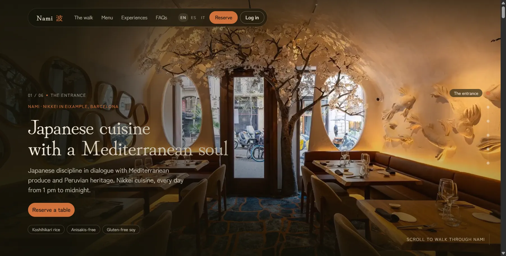
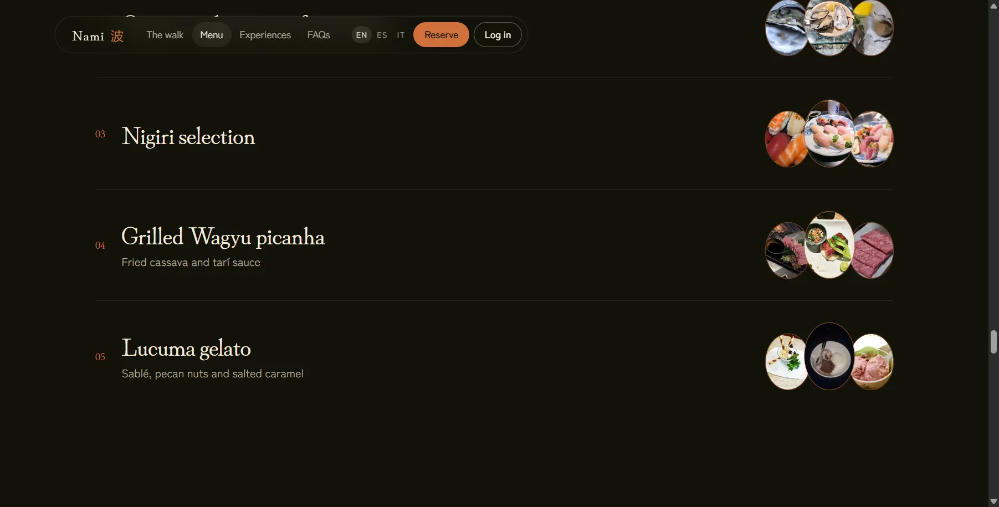
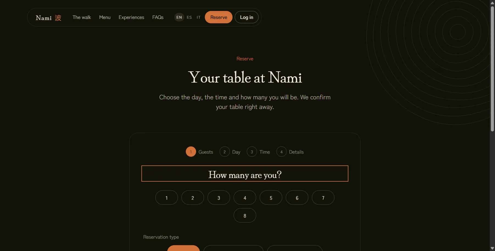
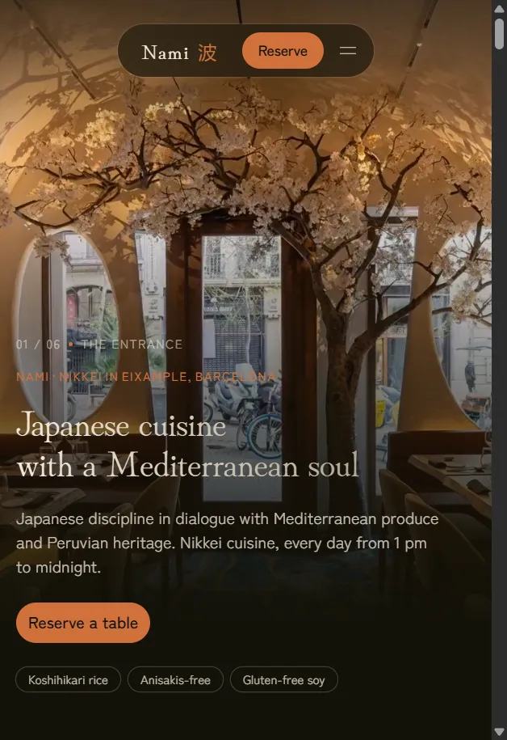

<div align="center">

[](#features)
[](#features)
[](#features)

</div>

# Nami

Nikkei restaurant in Barcelona — Astro + Wix Headless, deployed on Cloudflare Workers. [Report a bug](https://github.com/20essentials/project-1419/issues) · [Suggest a feature](https://github.com/20essentials/project-1419/issues)

An English-first restaurant site built on **Wix** as the backend (table reservations, menus, members, gift cards, hosted checkout) and **Astro 7** as the SSR frontend. The design is a dark, warm aesthetic driven by a cinematic _scroll-world_: six pre-rendered clips you walk through as you scroll — cherry tree entrance, mirrors, round table, dining room, sushi counter and bar. The step-by-step status lives in `ROADMAP.md`.

Table of contents

- [Features](#features)
- [Getting Started](#getting-started)
  - [Prerequisites](#prerequisites)
  - [Installation](#installation)
- [Contributing to the project](#contributing-to-the-project)
- [🛠️ Stack](#%EF%B8%8F-stack)
- [Wix apps](#wix-apps)
- [Structure](#structure)
- [Scripts](#scripts)
- [Languages & translations](#languages--translations)
- [Deployment](#deployment)
- [How this is built](#how-this-is-built)
- [Docs](#docs)

---

## Features

[](#features)

- **Home** with a cinematic _scroll-world_ landing: 6 stops, each a pre-rendered clip with a poster (GSAP + Lenis).
- **Reservations** with a 4-step wizard (`/reserve/`): guests → day → time → details, slots from **Wix Table Reservations**, experience pre-selected via `?experience=`.
- **Menu** (`/menu/`) rendered live from **Wix Restaurants** (5 categories × 16 dishes) with 600 s cache and a static fallback; 3 photos per dish.
- **Experiences** for two with fixed price: Short (€150), Full (€250, most popular) and wine pairing (+€100).
- **Gift cards** (`/gift/`) — real Wix product with presets 150/250 + custom 50–1000, add-to-cart and **hosted checkout**.
- **Members** — custom login (`/login/`) and signup with email/password and Google/Facebook, HttpOnly cookie sessions, invisible captcha.
- **Account** (`/account/`) — editable profile, order history via `@wix/ecom` and reservation history via `searchReservations`.
- **FAQs**, press quotes and Google reviews rating (4.8 · 320 reviews).
- **4 legal pages** (legal notice, privacy, cookies, purchase terms) with JSON-LD.
- **Multilingual** — English default + `/es/` + `/it/` with a language switcher, per-locale SEO, hreflang and i18n sitemap.

<div align="center">

[](#features)

</div>

---

## Getting Started

[](#getting-started)

### Prerequisites

[](#prerequisites)

- **Node ≥ 24.22.1** (required by the Wix CLI):

  pnpm runtime set node 24 -g

- **pnpm** (the project uses exact versions, no carets):

  npm install pnpm@latest -g

> **Why pnpm and not npm?** This project standardized on pnpm (see `AGENTS.md`); dependencies are pinned to exact versions and `pnpm-lock.yaml` is the only lockfile.

### Installation

[](#installation)

1.  Clone the repository

    git clone https://github.com/20essentials/project-1419.git
    cd project-1419

2.  Install dependencies

    pnpm install

3.  Link the project to its Wix site (`wix.config.json`, already committed) and log in

    pnpm wix login

4.  Run the project

    pnpm dev # http://localhost:4321

5.  Build and deploy

    pnpm build # wix translation pull + astro build
    pnpm deploy # astro build + wrangler deploy to Cloudflare Workers

([back to top](#readme-top))

---

## Contributing to the project

[](#contributing-to-the-project)

Suggestions and improvements are welcome! Open an [_issue_](https://github.com/20essentials/project-1419/issues) with the "enhancement" tag, or fork the repository and open a [_pull request_](https://github.com/20essentials/project-1419/pulls).

Quick guide:

1.  [_Fork_](https://github.com/20essentials/project-1419/fork) the Project
2.  Clone your fork and create your feature branch (`git switch -c feature/AmazingFeature`)
3.  Follow the conventions in `AGENTS.md` (pnpm, kebab-case files, no `export default`, Tailwind v4 canonical classes, no code comments)
4.  Commit your changes and push the branch
5.  Open a [_pull request_](https://github.com/20essentials/project-1419/pulls)

([back to top](#readme-top))

---

## 🛠️ Stack

[](#️-stack)

- [](https://astro.build/) - SSR on Cloudflare Workers (`output: 'server'` + `@astrojs/cloudflare`).
- [](https://dev.wix.com/docs/go-headless/get-started/about-wix-headless) - Self-managed backend via `@wix/sdk` (no `@wix/astro`): reservations, menus, members, eCommerce, gift vouchers.
- [](https://developers.cloudflare.com/workers/) - Hosting with `wrangler`.
- [](https://tailwindcss.com/) - Utility-first styling with `@theme` tokens.
- [](https://gsap.com/) - Scroll-world choreography with Lenis smooth scroll.
- [](https://playwright.dev/) - E2E tests with mocked and real opt-in flows.

([back to top](#readme-top))

---

## Wix apps

[](#wix-apps)

Apps the project uses and what each one powers.

Status

Wix app

Features / pages / sections this site uses

✅

**Wix Table Reservations**

`/reserve/` wizard (setup → slots → create reservation), LUN–DOM 13:00–23:00 config

✅

**Wix Restaurants**

Live menu on `/menu/` (categories, dishes, prices) fetched SSR-side with cache

✅

**Wix eCommerce**

Gift card add-to-cart + hosted checkout, order history in `/account/`

✅

**Wix Gift Vouchers**

Gift card product with preset amounts and custom value

✅

**Wix Members**

Custom login/signup, Google & Facebook OAuth, HttpOnly cookie sessions, `/account/`

✅

**Wix Multilingual**

Language selector `en` / `es` / `it` · Translation Manager push/pull flow · per-locale SEO

---

## Structure

[](#structure)

Screaming Architecture: the folders scream **what the business does**, not what technology it uses (see the rules in `AGENTS.md`).

```
src/
├── app/            # app chrome: layout.astro, header, footer, logo, language-switcher
├── features/       # ONE folder per business capability (no barrels, imports by file path)
│                   # home, menu, experiences, reserve, gift, account, auth,
│                   # faq, press, final-cta, legal
├── shared/         # cross-cutting infra: i18n, wix, site (nami/photos/tour), seo, ui, auth
├── pages/          # thin routes (Astro requirement): compose features, no logic
├── styles/         # global.css + @theme tokens
├── assets/         # photos (webp/avif), paseo posters, fonts
└── tests/          # Playwright E2E (mocked + real contract opt-in)
```

Rules: features never import from other features (shared things → `src/shared/`); `src/pages` only composes; every file inside `src/` is **kebab-case**; assets referenced from TS/Astro use `baseUrl(...)`; no `export default` except API routes and `.astro` files.

([back to top](#readme-top))

---

## Scripts

[](#scripts)

Command

Description

`pnpm dev`

Dev server (http://localhost:4321)

`pnpm build`

`wix translation pull` + `astro build`

`pnpm preview`

Preview the production build

`pnpm deploy`

`astro build` + `wrangler deploy` to Cloudflare Workers

`pnpm test:e2e`

Playwright E2E (frees port 4321 afterwards)

`pnpm translations:pull`

Pull translations from the Wix dashboard to `.wix/multilingual/`

`pnpm translations:push`

Push new keys from `src/translations.json` to the Wix dashboard

([back to top](#readme-top))

---

## Languages & translations

[](#languages--translations)

English is the primary language and the source of keys: `src/translations.json` (≈ 460 keys). Push/pull flow with the Wix dashboard's Translation Manager (`Wix Multilingual`):

- Editors translate in the dashboard: **Website Content → Multilingual → Edit Translations → Headless tab**, then _Save and Publish_. Since the runtime-translations step, published edits go live in **~5 minutes** without a deploy.
- `getT()` (`src/shared/i18n/`) is async and serves es/it **at runtime** from the Wix translation-content API, cached in memory (60 s) and in KV (`TRANSLATIONS`, 5 min TTL + warm backup), with the build-time JSON as final fallback.
- `pnpm translations:pull` downloads the JSON to `.wix/multilingual/translations/{es,it}.json`; the pulled JSON is committed, so builds are reproducible without a CLI session. `pnpm build` attempts `wix translation pull` before `astro build`; in CI use `wix login --api-key`.
- To push new keys to the dashboard: `pnpm translations:push` (it deletes unused keys — careful).

([back to top](#readme-top))

---

## Deployment

[](#deployment)

The site is a **Wix Headless self-managed** project: it does _not_ deploy to Wix Hosting.

- `pnpm deploy` builds with Astro and publishes to **Cloudflare Workers** with `wrangler` (`wrangler.jsonc`).
- Live site: **https://nami-sushi.nami-sushi.workers.dev** — the public and canonical URL (no custom domain; canonical, sitemap, hreflang and JSON-LD all use it).
- Secrets live in `.dev.vars` locally and as Cloudflare/Wix secrets in production — never commit them.
- Real payments (Wix Payments) are parked until the owner upgrades; online reservations already work. There is no custom domain: the workers.dev URL is the production site.

([back to top](#readme-top))

---

## How this is built

[](#how-this-is-built)

The site is developed **step by step**. Every `.opencode/commands/step-N-*.md` file is the source of truth for what to do next; run them in order.

- `ROADMAP.md` — backlog status (`pending` → `✅ done` → `🅿️ parket`) and closed decisions.
- `AGENTS.md` — conventions, work rules and environment.

Current state: **23 / 24 steps done, 1 in progress** — infrastructure, i18n (with runtime translations from the Wix API + KV), reservations (wizard + E2E), live menu, legal pages, custom auth, account (orders + reservations), gift cards, dish photos, experiences, cancellation policy, Google reviews and the Cloudflare deploy. In progress: production auth smoke on the workers.dev URL (the OAuth allow-list is already registered there).

([back to top](#readme-top))

---

## Docs

[](#docs)

- [Wix Headless](https://dev.wix.com/docs/go-headless/get-started/about-wix-headless)
- [Wix REST API](https://dev.wix.com/docs/api-reference)
- [Wix JS SDK](https://dev.wix.com/docs/sdk)
- [Astro docs](https://docs.astro.build/)
- [Cloudflare Workers docs](https://developers.cloudflare.com/workers/)

([back to top](#readme-top))
